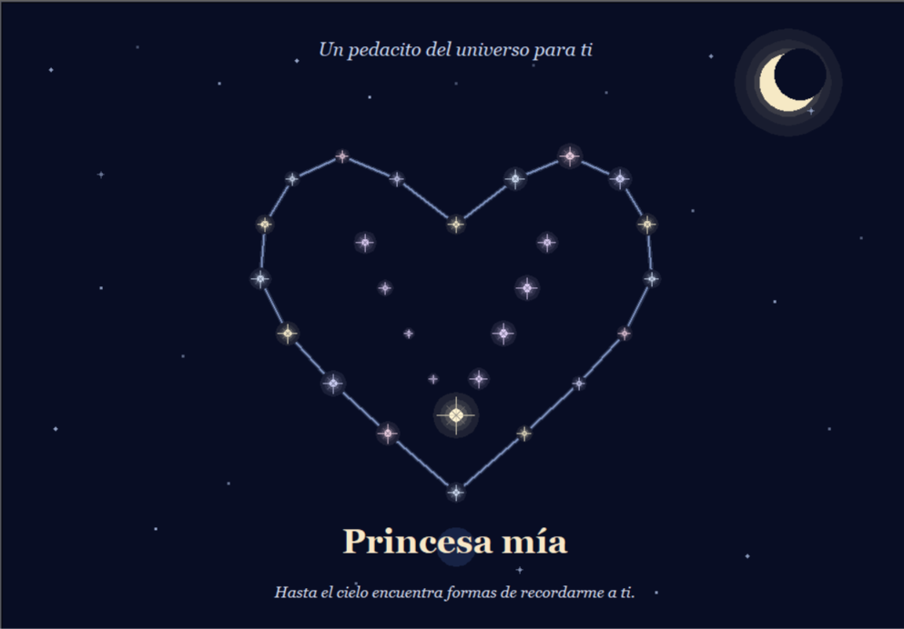

# ✨ A Constellation for Valbb ♡

Somewhere among all the stars, there's a little constellation that reminds me of you.

This project is a romantic animation created with **Python Turtle**, featuring a heart-shaped constellation that slowly comes to life, one star at a time.

As the stars illuminate the night sky, a little **V** appears inside the heart, representing Valbb. A shooting star crosses the scene, and a special message slowly reveals itself beneath the constellation.

A little piece of the universe, created for someone who makes mine feel brighter.

## ✨ Features

- 💗 **Heart-Shaped Constellation:** Stars gradually appear and connect to form a beautiful heart.
- ⭐ **A Hidden V:** A second arrangement of independent stars forms the letter "V" inside the heart, representing Valbb.
- 🌙 **Crescent Moon:** A softly glowing moon illuminates the night sky.
- ✨ **Twinkling Stars:** Distant stars gently change their brightness, creating a living night sky.
- ☄️ **Shooting Star:** A shooting star travels across the sky.
- 💌 **Romantic Dedication:** A special message appears once the constellation is complete.
- 🔄 **Seamless Animation Cycle:** The entire scene gently fades away and starts again.

## 🎨 Graphical Representation

The `graphical-representation` folder contains visual references and a video demonstration of the animation.

<p align="center">
  
</p>

<p align="center">
  <a href="graphical-representation/constellation.mp4">▶ Watch the animation</a>
</p>

## 🛠️ Technologies Used

- Python 3
- Turtle Graphics
- Tkinter
- Math
- Random
- Time

## 🎮 Controls

| Key | Action |
|:---:|:---|
| `SPACE` | Pause / Resume animation |
| `ESC` | Close the animation |

## 🚀 How to Run

1. Make sure Python 3 is installed on your computer.
2. Clone this repository:

   ```bash
   git clone https://github.com/laetg404/a-constellation-for-valbb.git
   ```

3. Navigate to the project directory:

   ```bash
   cd a-constellation-for-valbb
   ```

4. Run the Python script:

   ```bash
   python main.py
   ```

The animation window will open automatically.

## 📁 Project Structure

```text
a-constellation-for-valbb/
│
├── graphical-representation/
│   ├── constellation.png
│   └── constellation.mp4
│
├── main.py
└── README.md
```

## ♡ Written in the Stars

My princess,

If I could give you a little piece of the universe, I think I would choose the stars.

I would gather them one by one, arrange them into a heart, and hide a little letter V right in the middle, so that even the night sky would know who inspires all of this.

I know that no constellation could ever hold everything I feel for you, but I wanted to create one that would remind you that, among billions of stars, you will always be my favorite.

And whenever you look up at the sky, I hope you remember that somewhere, someone is thinking of you and finding little ways to turn their love into something beautiful.

**Until the stars run out of ways to remind me of you. ♡**

All my love, always.

---

<sub>Part of a collection of little projects created with love.</sub>

✨
